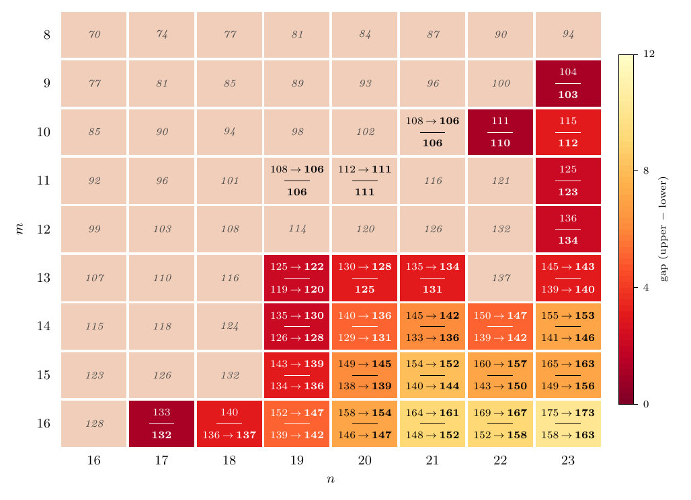
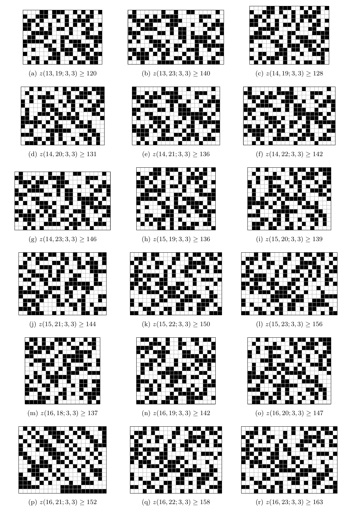

# New bounds and three exact values for the Zarankiewicz numbers z(m,n;3,3)

The Zarankiewicz number z(m,n;3,3) is the maximum number of ones in an m×n binary
matrix with no 3×3 all-ones submatrix. This repository contains:

- explicit matrices that improve the best known **lower bounds** for 18 of these
  numbers, with 13 ≤ m ≤ 16 and 18 ≤ n ≤ 23, by up to 7;
- **upper bounds** obtained by applying the density lemma of Collins et al. to known
  exact values, which improve 22 upper bounds and settle three cells:
  z(10,21) = 106, z(11,19) = 106 and z(11,20) = 111;
- the search code, an independent verifier, the consolidated bounds from the
  literature with their sources, and the LaTeX note describing everything.

**Paper:** [paper/main.pdf](paper/main.pdf)

## Results



Beige cells are values known exactly, including the three settled here. In the other
cells the top number is the best known upper bound, the bottom number the best lower
bound, and the colour the gap between them; "a → **b**" marks an improvement from the
previous best bound a to b.

| (m,n) | previous lower bound | new lower bound | upper bound |
|---|---|---|---|
| (13,19) | 119 | 120 | 122 |
| (13,23) | 139 | 140 | 143 |
| (14,19) | 126 | 128 | 130 |
| (14,20) | 129 | 131 | 136 |
| (14,21) | 133 | 136 | 142 |
| (14,22) | 139 | 142 | 147 |
| (14,23) | 141 | 146 | 153 |
| (15,19) | 134 | 136 | 139 |
| (15,20) | 138 | 139 | 145 |
| (15,21) | 140 | 144 | 152 |
| (15,22) | 143 | 150 | 157 |
| (15,23) | 149 | 156 | 163 |
| (16,18) | 136 | 137 | 140 |
| (16,19) | 139 | 142 | 147 |
| (16,20) | 146 | 147 | 154 |
| (16,21) | 148 | 152 | 161 |
| (16,22) | 152 | 158 | 167 |
| (16,23) | 158 | 163 | 173 |

The source of every bound is listed in `literature.csv` and in Table 1 of the note.
Some upper bounds depend on a computer-assisted proof in a preprint (arXiv:2608.08154);
they are marked in the note.

## The matrices

The 18 matrices with improved lower bounds (black = 1, white = 0):



## Verify the matrices

Each matrix is in `results/Z_m_n.txt`, one row per line. The checker is plain Python
and shares no code with the search:

```bash
python3 verify.py results/Z_*.txt
```

It tests every triple of rows and, independently, every triple of columns.

## Layout

| Path | Contents |
|---|---|
| `results/` | best matrices found for every cell 8 ≤ m ≤ 16, 16 ≤ n ≤ 23 |
| `verify.py` | independent verifier |
| `search/` | the local search (C + OpenMP) and a script to build and run it |
| `literature.py` | bounds from the literature (with sources), closed under the elementary rules; writes `literature.csv` for all 72 cells |
| `sat/` | SAT encodings (Kissat) and their self-tests; also an attempted independent per-profile check of z(13,22) ≤ 137, which did not finish (see below) |
| `paper/` | the LaTeX note; `paper/build.sh` regenerates its tables, figures and the README images from `results/` |
| `Dockerfile` | Ubuntu 24.04 with gcc, Python, TeX Live and Kissat |

## Reproduce

```bash
docker build -t zaran .
docker run --rm -v "$PWD:/work" zaran bash search/run.sh -t 1     # 1 hour of search
docker run --rm -v "$PWD:/work" zaran ./paper/build.sh            # rebuild the note
```

The search compiles inside the container with `-march=native`, resumes from
`results/`, and saves every improvement there.

## Attempted check of z(13,22) ≤ 137

Twelve upper bounds in the note depend on z(13,22) = 137, whose upper bound comes from a
computer-assisted proof in a preprint (arXiv:2608.08154). We tried to check it
independently. A counting argument (`sat/afr_step1.py`) leaves 83 column-degree profiles
for a 13×22 matrix with 138 ones, as stated in the preprint. We then asked Kissat, profile
by profile, whether a valid matrix exists (`sat/profile_sat.py`, rows in lexicographic
order, columns sorted by degree). The method is correct on small known cases
(`sat/profile_test.sh`, e.g. z(10,11) = 64), but at 13×22 each of the 30 profiles that
ran for the full 2-hour limit timed out, including a control profile that is known to be
satisfiable; we then stopped the remaining runs. A stronger encoding would be needed.
